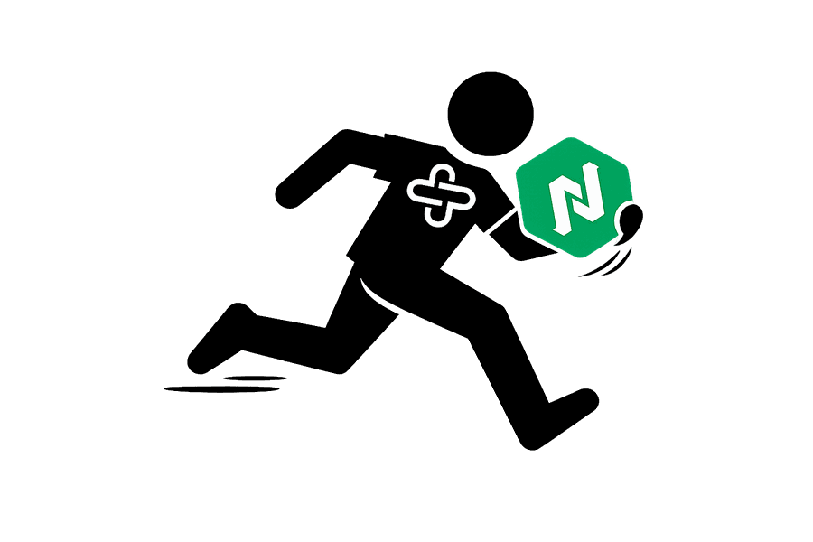
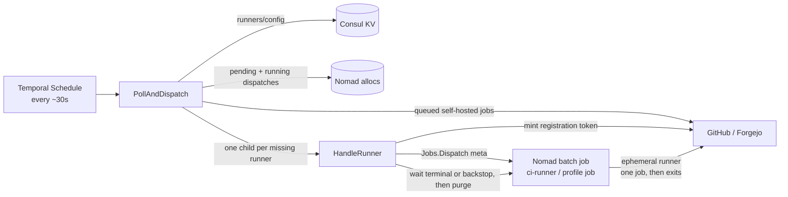

<p align="center">
  
</p>

# Nomad Temporal Jobs

[](https://github.com/afreidah/nomad-temporal-jobs/actions/workflows/ci.yml)
[](https://sonarcloud.io/summary/new_code?id=afreidah_nomad-temporal-jobs)
[](https://sonarcloud.io/summary/new_code?id=afreidah_nomad-temporal-jobs)
[](https://opensource.org/licenses/MIT)

<p align="center">
  <strong><a href="https://nomad-temporal-jobs.munchbox.cc">Project Website</a></strong>
</p>

Temporal workflows that run a Nomad, Consul and Vault cluster: **on-demand CI runners**, Raft snapshots, image scanning, storage reclamation, and certificate and token renewal. Every job is a durable workflow. A run that fails part-way resumes where it stopped, and a job that takes a service offline always brings it back. Workers reach the cluster through native Go clients rather than a remote shell.

The main component is the **CI runner scaler**. It turns Nomad parameterized batch jobs into self-hosted GitHub Actions and Forgejo Actions runners that exist only while a job is queued. There is no idle runner fleet: the scaler watches the forge's queue, dispatches one ephemeral Nomad batch job per missing runner, and reaps it when the CI job finishes. See [On-Demand CI Runners](#on-demand-ci-runners).

### Highlights

- **Scale-to-zero CI runners on Nomad.** Queued `self-hosted` jobs on GitHub or Forgejo become ephemeral runners dispatched as Nomad batch jobs. Label-based profiles route each job to its own runner pool (VM, Go toolchain, default), and `maxConcurrent` caps each pool. Registration tokens are minted inside activities, so they never land in workflow history.
- **Backups** of Nomad Raft, Consul Raft (which holds Vault's data) and every PostgreSQL database, uploaded to S3 with tag-based lifecycle.
- **Trivy scanning** of every image running in Nomad, with CVE results stored in PostgreSQL.
- **Maintenance sagas** that scale a service to 0, do the offline work (registry GC, `aptly db cleanup`), and always scale it back, even on failure or cancellation.
- **Node cleanup** of orphaned allocation directories, Docker and containerd image stores, stale rootfs entries and buildx volumes, all through SFTP and tunneled Docker/containerd APIs.
- **Secrets without static tokens.** Workers log in to Vault with Nomad Workload Identity. The cert acquirer issues the wildcard certificate over ACME DNS-01, and the token renewer keeps repository CI secrets fresh using a GitHub App.
- **Fully traced.** OpenTelemetry spans carry `peer.service` for every external call, the Temporal SDK exposes Prometheus metrics, and logs are JSON `slog`.

**Seven worker binaries host ten scheduled jobs.** Six workers map to one job each: CI runner scaling, backup, vulnerability scanning, certificate acquisition, GitHub token renewal, and media-library import. The **cleanup worker** hosts four maintenance workflows on a shared task queue: node cleanup, registry GC, aptly cleanup, and PostgreSQL `VACUUM`. Each worker is its own container image with its own Nomad service job. Temporal Schedules fire the workflows on cron; the schedules are managed as code in the `infrastructure/terragrunt` repo.

```
  Temporal Schedules            Temporal Server
  (Terraform-managed)           (temporal-server.service.consul:7233)
         |                               |
         | start workflow on cron        | Task Queue dispatch
         v                               v
                            +------------------------+
                            | ci-runner-scaler       |  <-- on-demand CI runners
                            | ci-runner-scaler-      |      (Nomad batch dispatch)
                            |  task-queue            |
                            +------------------------+
                            | backup-worker          |
                            | backup-task-queue      |
                            +------------------------+
                            | trivy-scan-worker      |
                            | trivy-task-queue       |
                            +------------------------+
                            | cleanup-worker         |
                            | cleanup-task-queue     |
                            | (cleanup, registry-gc, |
                            |  aptly, postgres-maint)|
                            +------------------------+
                            | cert-acquirer-worker   |
                            | cert-task-queue        |
                            +------------------------+
                            | github-token-renewer   |
                            | (github-token-renewer- |
                            |  task-queue)           |
                            +------------------------+
                            | media-import-worker    |
                            | media-import-task-queue|
                            +------------------------+
                                        |
                                        v
                              Nomad, Consul, Vault,
                              GitHub, Forgejo, S3,
                              PostgreSQL, Trivy,
                              SSH (client nodes),
                              ACME, Cloudflare,
                              Deluge, Sonarr, Radarr,
                              Jellyfin
```

Each worker is a long-running Temporal worker process that polls its dedicated task queue. Workflows are pure orchestration; all I/O happens in activities. Activities are registered as struct methods, sharing pooled connections (DB, S3) across invocations.

## Table of Contents

- [On-Demand CI Runners](#on-demand-ci-runners)
- [Workflow Domains](#workflow-domains)
- [Maintenance Sagas](#maintenance-sagas)
- [Shared Infrastructure](#shared-infrastructure)
- [Scheduling](#scheduling)
- [Retry and Error Handling](#retry-and-error-handling)
- [Configuration](#configuration)
- [Observability](#observability)
- [Development](#development)
- [Deployment](#deployment)
- [Project Structure](#project-structure)

## On-Demand CI Runners

The `ci-runner-scaler` worker gives GitHub and Forgejo repositories self-hosted runners **only while there is work**. Each runner is a Nomad *parameterized batch job*. The scaler dispatches one instance per queued CI job, the runner registers as ephemeral, takes exactly one job, and exits. When the queue is empty, nothing runs and no capacity sits reserved.



### How a tick works

`PollAndDispatch` runs on a short Temporal Schedule (calendar `second=0,30`):

1. **Load config.** It reads the per-repo provisioning map from Consul KV (`runners/config`). Repos are sorted so the workflow replays deterministically.
2. **Find demand.** For each repo it lists queued jobs whose `runs-on` includes `self-hosted`, at most `concurrency` repos at a time. GitHub has no "list queued jobs" endpoint, so the scaler walks the queued and in-progress workflow runs and collects their queued jobs. Forgejo lists runner jobs directly and counts only jobs that are `waiting` and not yet claimed. If one repo's poll fails, that repo is skipped for the tick and the rest still run.
3. **Find supply.** It counts the runner dispatches that are pending or running in Nomad across the default job and every profile job, reading each one's `repo_url` and `labels` dispatch meta. If this count fails, the whole tick fails, because dispatching without a count would over-provision.
4. **Reconcile by depth.** Queued jobs and active runners are both bucketed by `(repo, sorted labels)`. For each bucket the scaler starts `queued − active` `HandleRunner` children, capped by `maxConcurrent`; overflow stays queued on the forge until a slot frees. An ephemeral repo-scoped runner isn't bound to a particular job, since the forge hands any label-matching runner whichever job is next. That makes depth reconciliation idempotent without per-job dedupe or an external state store: a bucket left short is topped up on the next tick.

`HandleRunner` owns one runner's lifecycle:

- **Dispatch.** It mints a registration token inside the activity, so the token never enters Temporal history. It then calls Nomad `Jobs.Dispatch` with meta `repo_url`, `labels`, `runner_token` (or `runner_secret`, a Vault path, in `vault` mode) and an optional `runner_image`. Dispatch runs with no retry and a 2-minute timeout.
- **Wait.** It polls the dispatched job every 5s and heartbeats, until the job is terminal or the `reap_after` backstop expires (default 1h).
- **Reap.** On finish, timeout or cancellation alike, it purges the dispatched job on a disconnected context. A runner that never picked up its job is therefore never left holding a slot.

### Modes

Each repo picks a `mode`, which decides how the scaler polls and who mints the registration token:

| Mode | Polls with | Registration token | Use for |
|------|-----------|--------------------|---------|
| `app` (default) | The shared GitHub App, using an installation token scoped to the repo | Minted by the scaler at dispatch time | Repos where the App is installed |
| `vault` | A PAT from Vault at `vaultPath` (needs only Actions:read) | Nothing is minted. The runner job reads `registerVaultPath` (repo admin) and registers itself | Repos you collaborate on but don't own, keeping the poll credential separate from the admin one |
| `forgejo` | A Forgejo API token from Vault at `vaultPath`, against `forgejoUrl` | Minted per repo by the scaler at dispatch time | Self-hosted Forgejo repos, polled in the same loop as GitHub |

Stored tokens are re-read on every call, so a rotated secret takes effect without restarting the worker.

### Profiles

Ordered **profiles** map a distinguishing `runs-on` label to a parameterized Nomad job, with an optional image override. The first matching label wins. A repo can send `vm` jobs to a VM-capable pool and `go` jobs to a pool with a warm toolchain, while a bare `[self-hosted]` job falls back to the default `ci-runner`. Each profile, or the repo as a whole, can set `maxConcurrent` to cap that pool. See [Runner Scaler Worker](#runner-scaler-worker) for the config format.

**Task queue:** `ci-runner-scaler-task-queue`
**Workflows:** `PollAndDispatch`, `HandleRunner`
**Image:** `ci-runner-scaler`
**Dependencies:** Vault (Workload Identity; the App key for `app` repos, stored tokens for `vault`/`forgejo` repos), Consul KV (`runners/config`), GitHub and/or Forgejo API, Nomad (parameterized-job dispatch, allocation listing, purge)

## Workflow Domains

### Backup

Snapshots Nomad Raft state, Consul Raft state (includes Vault data), and PostgreSQL. The three legs run concurrently. The PostgreSQL leg dumps cluster-wide globals (roles, tablespaces, grants) once, enumerates the databases, then dumps each one to its own file with bounded concurrency (`PG_DUMP_CONCURRENCY`, default 4). Each artifact is stored locally on an NFS mount and uploaded to S3 for off-site redundancy. Old backups are cleaned up based on configurable retention (default: 7 days local, 30 days S3).

**Task queue:** `backup-task-queue`
**Schedule:** Nomad periodic job
**Image:** `backup-worker`
**Dependencies:** pg_dump/pg_dumpall (PostgreSQL 18 client), S3-compatible storage. Nomad and Consul snapshots are taken through their native Go APIs, so no Nomad/Consul CLI is bundled.

### Trivy Scan

Discovers all running Docker images from the Nomad API, scans them through the Trivy server with bounded concurrency, and stores CVE results in PostgreSQL. Transient errors (server down) are retried by Temporal; permanent errors (image not found) are recorded and skipped.

**Task queue:** `trivy-task-queue`
**Schedule:** Nomad periodic job
**Image:** `trivy-scan-worker`
**Dependencies:** Trivy CLI, Nomad API, PostgreSQL

### Node Cleanup

Removes Nomad job data directories that no longer correspond to a running allocation. Nodes are cleaned concurrently, bounded by a `concurrency` knob (each node is independent — its own host and daemon). The set of running jobs comes from the central Nomad API; the per-node directory work is done over SSH purely as native operations — directories are enumerated and deleted over **SFTP**, never a remote shell script. Removes only directories older than the grace period; optionally prunes unused Docker images through the Docker API (tunneled over SSH), and optionally reclaims the orphaned containerd `moby` image store through the containerd API (also tunneled) — the duplicate copy `docker system prune` can't reach on hosts running overlay2. The containerd prune is **store-aware**: it reads docker's live storage driver and skips itself where containerd is the live store, so it never deletes a live image. Two further optional sweeps reclaim leftovers that neither prune reaches: orphaned `/var/lib/docker/rootfs` entries (stale container root filesystems from a storage-layout change, removed over SFTP only when no live mount references them) and dangling buildx builder-state volumes (`buildx_buildkit_*_state` referenced by no container, removed through the Docker volume API). Supports dry-run mode for safe previewing.

**Task queue:** `cleanup-task-queue`
**Schedule:** Nomad periodic job
**Image:** `cleanup-worker`
**Dependencies:** SSH access to all Nomad client nodes, Nomad API

### Registry Garbage Collection

Reclaims disk space from the Docker registry by running the registry's `garbage-collect` against its bind-mounted storage. Because the registry tool requires the registry to be offline, the workflow scales the registry Nomad job to 0, waits for its allocations to drain, runs the `garbage-collect` as a one-shot container through the Docker API (tunneled over SSH), then scales it back to 1. It reports blobs deleted and bytes reclaimed (before/after sizes). Runs on the cleanup worker, sharing its SSH and Nomad-client infrastructure. See [Maintenance Sagas](#maintenance-sagas) for the compensation guarantees.

**Task queue:** `cleanup-task-queue` (shared with node cleanup)
**Workflow:** `RegistryGC`
**Image:** `cleanup-worker`
**Dependencies:** SSH access to the registry host, Nomad API (job scaling), Docker on the registry host

### Aptly Cleanup

Reclaims storage from the aptly Debian repository pool by running `aptly db cleanup` against the pool volume, dropping packages no longer referenced by any snapshot or repo. Because aptly holds a single-writer leveldb lock while running, the workflow scales the aptly Nomad job to 0, waits for its allocations to drain, runs the cleanup as a one-shot container through the Docker API (tunneled over SSH), then scales it back to 1. It reuses the same find / scale / wait / measure saga activities as registry GC and reports bytes reclaimed (before/after sizes). See [Maintenance Sagas](#maintenance-sagas) for the compensation guarantees.

**Task queue:** `cleanup-task-queue` (shared with node cleanup)
**Workflow:** `AptlyCleanup`
**Image:** `cleanup-worker`
**Dependencies:** SSH access to the aptly host, Nomad API (job scaling), Docker on the aptly host

### Postgres Maintenance

Runs online `VACUUM (ANALYZE)` across every database in the cluster to reclaim bloat and refresh planner statistics. Lists the non-template databases from the primary, then vacuums each with a bounded-concurrency fan-out (`Concurrency`, default 2) so the maintenance burst doesn't overwhelm the primary. Online and lock-light — no `FULL`. A per-database failure is recorded and the run continues; the workflow returns an error only after every database has been attempted.

**Task queue:** `cleanup-task-queue` (shared with node cleanup)
**Workflow:** `PostgresMaintenance`
**Image:** `cleanup-worker`
**Dependencies:** PostgreSQL primary (via the shared instrumented client)

### Cert Acquirer

Issues the `*.munchbox.cc` wildcard certificate via ACME DNS-01 (Cloudflare) using the `go-acme/lego` library, and publishes the result to Vault for Traefik to read. The ACME account is persisted to Vault so registration happens once rather than on every run. Issuance and publish are separate activities: the issued cert+key are written to a staging Vault path so a publish failure never re-runs ACME issuance (Let's Encrypt rate-limits duplicate issuance), and the private key never transits Temporal workflow history. The worker authenticates to Vault with its Nomad Workload Identity and pulls the Cloudflare token through that client; no static secrets are templated into the job.

**Task queue:** `cert-task-queue`
**Workflow:** `CertAcquirer`
**Image:** `cert-acquirer-worker`
**Dependencies:** Vault (Workload Identity), Cloudflare DNS API, Let's Encrypt

### GitHub Token Renewal

Keeps each managed repository's CI/release token secret continuously valid so it never expires — replacing hand-rotated Personal Access Tokens. The workflow reads the `owner/repo` list from Consul KV, then for each repo mints a short-lived GitHub App installation token scoped to that repo (`contents` + `pull-requests: write`), seals it with a NaCl box against the repo's Actions public key, and writes it to the repo's `RELEASE_PAT` Actions secret via a separate `secrets: write` token. Re-minting on every scheduled run means the secret is always fresh; a per-repo failure is recorded and the run continues, failing the workflow only after every repo has been attempted. One GitHub App, installed across all repos, is the only way to mint PR-capable tokens programmatically — a user PAT can't be API-minted. All GitHub I/O uses the native `go-github` client, never the `gh` CLI. The worker authenticates to Vault with its Nomad Workload Identity and pulls the App private key through that client; no static secrets are templated into the job.

**Task queue:** `github-token-renewer-task-queue`
**Workflow:** `RenewTokens`
**Image:** `github-token-renewer`
**Dependencies:** Vault (Workload Identity, holds the App key), Consul KV (repo list), GitHub API

### Media Import

Reconciles torrents grabbed in Deluge *outside* of Sonarr/Radarr into the media library so Jellyfin can see them. Downloads that Sonarr/Radarr never initiated have no queue entry, so Completed Download Handling ignores them — they sit in the download folder forever, invisible to Jellyfin. The `Reconcile` workflow lists the torrents Deluge reports as 100% complete (in-progress ones are skipped so partial files are never linked), then offers each folder to Sonarr (TV) and, on no series match, Radarr (movies) through their manual-import API with `importMode=Copy` — hardlinking the genuinely-missing episodes/movie into the library while the torrent keeps seeding. It imports only what's actually missing: duplicates and quality-downgrades ("not an upgrade") are skipped, and the multi-season-pack guard ("episode unexpected") is overridden with explicit episode mappings. A single Jellyfin scan fires when anything imported; folders with no series/movie match or unmappable release names are logged for a human. The worker authenticates to Vault with its Nomad Workload Identity and pulls the Sonarr/Radarr/Deluge/Jellyfin credentials through it; no static secrets are templated into the job.

**Task queue:** `media-import-task-queue`
**Workflow:** `Reconcile`
**Image:** `media-import-worker`
**Dependencies:** Vault (Workload Identity), Deluge (WebUI JSON-RPC), Sonarr + Radarr (manual-import API), Jellyfin (library scan)

## Maintenance Sagas

The registry GC and aptly cleanup workflows share one saga skeleton so the job being maintained is never left stranded offline: scale it to 0, do the work while it's down, then always scale it back. The generic steps — locate the job's node, scale, wait for drain/running, measure the data dir — are the **shared saga activities** (`maintenance/internal/nodes`); only the middle "do the work" step is job-specific. Each step has its own retry policy:

| Step | Activity | Retry |
|------|----------|-------|
| Locate the job's host | `FindJobNode` | 3 attempts, exponential backoff |
| Measure storage (before) | `MeasureDataDir` | 3 attempts |
| Scale job to 0 | `ScaleJob` | 3 attempts (idempotent) |
| Wait for allocs to drain | `WaitJobDrained` | bounded by timeout, heartbeats each poll |
| Do the work | `RunRegistryGarbageCollect` / `RunAptlyDBCleanup` | **1 attempt** (no retry on partial work) |
| Measure storage (after) | `MeasureDataDir` | 3 attempts |

Once the scale-down to 0 succeeds, a **compensation** is registered with `defer` and `workflow.NewDisconnectedContext`. It scales the job back to 1 (`ScaleJob`) and waits for a running allocation (`WaitJobRunning`) — and it always fires, even if the work step fails, an activity times out, or the workflow is cancelled mid-flight. Scaling is idempotent, so re-issuing `count=1` is a safe no-op on the happy path. If the scale-back itself fails, the workflow logs a `CRITICAL` recovery message and joins the error so it surfaces to the operator.

| Config | Default | Description |
|--------|---------|-------------|
| `JobName` | `registry` | Nomad job for the registry |
| `GroupName` | (= `JobName`) | Task group to scale |
| `RegistryDataDir` | `/mnt/gdrive/munchbox-data/registry` | Host path bind-mounted as `/var/lib/registry` |
| `RegistryImage` | `registry:3` | Image used for the one-shot GC run |
| `DryRun` | `true` (overridden by schedule input) | Report blobs that would be deleted without freeing space |
| `DeleteUntagged` | `true` | Also remove manifests not referenced by any tag |

## Shared Infrastructure

The `shared/` package provides common functionality used by all workers:

| Path | Purpose |
|------|---------|
| `runtime.go` | `RunWorker`, the common worker bootstrap: tracing, logging, metrics, Temporal client and interceptor, namespace selection, workflow/activity registration, run-until-interrupt. Each worker's `main.go` is about 15 lines. |
| `telemetry.go` | OpenTelemetry tracer init, span helpers, `peer.service` attributes |
| `logging.go` | JSON slog logger wrapped for Temporal SDK compatibility |
| `metrics.go` | Prometheus metrics handler for Temporal SDK metrics (Tally bridge) |
| `temporal.go` | Shared retry-policy and activity-option presets (`StandardRetry`, `NoRetry`, `QuickActivityOptions`, `LongActivityOptions`) |
| `heartbeat.go` | `WithHeartbeat`: runs a function while emitting activity heartbeats |
| `client/nomad/` | OTel-instrumented Nomad client and service: running images, client nodes, find-job-node, idempotent scaling, alloc waits, parameterized dispatch, active runner slots |
| `client/git/` | GitHub clients: App installation tokens, queued-job lister and registration-token minter, PAT-backed lister, repo list, Vault-backed construction |
| `client/forgejo/` | Forgejo Actions client: queued runner jobs and per-repo registration tokens |
| `client/vault/` | Self-authenticating Vault client (Workload Identity + KV) |
| `client/consul/` | OTel-instrumented Consul client (Raft snapshots, KV), with its token sourced from Vault |
| `client/postgres/` | OTel-instrumented PostgreSQL connection factory and maintenance service (list databases, VACUUM ANALYZE) |
| `client/s3store/` | `S3Store`: multipart upload, listing, and retention / quota eviction over an S3-compatible API |
| `client/sonarcloud/` | SonarCloud API client |
| `client/ssh/` | Certificate-authenticated SSH client that re-reads its short-lived cert on every connection. Provides SFTP file operations and tunnels the Docker and containerd APIs over the SSH connection (one-shot containers, prune, store-aware `moby` reclaim), plus the mount-guarded rootfs sweep and buildx volume removal. No remote shell. |

Reusable clients (`Nomad`, `Postgres`, `Consul`, `S3Store`, `VaultClient`) are concrete `shared` services; each worker declares its own **narrow consumer interface** over the subset it calls (e.g. `nomadImages`, `pgMaintainer`, `s3Store`), satisfied structurally. Workers depend on small, testable surfaces and the shared client can grow without bloating existing consumers.

All workers use `StartPeerSpan` to produce service graph edges in Tempo/Grafana for every external call (Nomad, Consul, PostgreSQL, S3, Trivy server, Vault, ACME, Cloudflare).

**No remote shell.** Workers operate remote infrastructure through native Go APIs end-to-end — Nomad/Consul snapshots and job control via their APIs, the remote Docker daemon over an SSH socket tunnel, and remote files over SFTP. The cleanup worker connects as `root` everywhere (the Vault SSH CA issues a root principal the Oracle hosts accept), so no per-node user/sudo handling is needed. The only remaining subprocesses are `pg_dump`/`pg_dumpall`, which have no Go-native equivalent and whose output is gzipped in-process.

## Scheduling

Workflows fire on cron from Temporal Schedules, defined as code in `infrastructure/terragrunt` (the `temporal-config` module, applied via the `global/temporal-config` leaf). Each schedule starts one workflow on its task queue with a JSON `input` that deserializes into the workflow's config struct. The workers themselves just poll their queues — nothing in this repo triggers them.

| Schedule | Workflow | Task Queue | Cron | Input |
|----------|----------|------------|------|-------|
| `backup-daily` | `Backup` | `backup-task-queue` | `0 1 * * *` | `BackupConfig` (local/S3 days, S3 cleanup toggle, dump concurrency) |
| `trivy-daily` | `Scan` | `trivy-task-queue` | `0 3 * * *` | `ScanConfig` (scan concurrency) |
| `cleanup-daily` | `Cleanup` | `cleanup-task-queue` | `0 5 * * *` | `CleanupConfig` (data dir, grace days, concurrency, dry-run, docker prune, containerd prune, rootfs prune, buildx volume prune) |
| `registry-gc-weekly` | `RegistryGC` | `cleanup-task-queue` | `0 2 * * 0` | `RegistryGCConfig` (job/dir/image, dry-run, delete-untagged) |
| `aptly-cleanup-weekly` | `AptlyCleanup` | `cleanup-task-queue` | `0 4 * * 0` | `AptlyCleanupConfig` (job/group/image, data dir) |
| `postgres-maintenance-weekly` | `PostgresMaintenance` | `cleanup-task-queue` | `0 6 * * 0` | `PostgresMaintenanceConfig` (concurrency) |
| `cert-acquirer-weekly` | `CertAcquirer` | `cert-task-queue` | `0 4 * * 1` | `IssueRequest` (domains, email) |
| `ci-runner-scaler` | `PollAndDispatch` | `ci-runner-scaler-task-queue` | every ~30s (calendar, `second=0,30`) | `PollConfig` (scan concurrency, reap backstop) |
| `media-reconcile` | `Reconcile` | `media-import-task-queue` | `0 */2 * * *` | `ReconcileConfig` (concurrency, dry-run) |

## Retry and Error Handling

### Activity Timeouts

Each activity has both a `StartToCloseTimeout` (max time for a single attempt) and a `ScheduleToCloseTimeout` (max total time including all retries). Quick operations (Nomad/Consul snapshots, globals dump, database listing, S3 uploads, cleanup) use 5/15 minute timeouts. Long operations (per-database `pg_dump`, image scanning) use 30/60 minute timeouts; per-database dumps additionally heartbeat with a 2 minute timeout.

### Retry Policy

All activities share a common retry policy with exponential backoff:

| Parameter | Value |
|-----------|-------|
| Initial interval | 1 second |
| Backoff coefficient | 2.0 |
| Maximum interval | 1 minute |
| Maximum attempts | 3 |

### Error Classification (Trivy Scan)

Trivy scan activities distinguish between transient and permanent failures:

| Error Type | Examples | Behavior |
|------------|----------|----------|
| Transient | Connection refused, timeout, connection reset | Returns error; Temporal retries automatically |
| Permanent | Image not found, manifest unknown | Returns `NonRetryableApplicationError`; Temporal stops immediately |
| Parse failure | Invalid trivy JSON output | Returns `NonRetryableApplicationError` |

### Backup Failure Behavior

| Step | On Failure |
|------|-----------|
| Nomad/Consul snapshot | Leg fails; workflow terminates with error |
| PostgreSQL globals dump or database listing | Leg fails; workflow terminates with error |
| Per-database dump | Leg fails after all databases are attempted; workflow terminates with error |
| S3 upload | Warning logged, workflow continues |
| S3 quota exceeded | Oldest backup evicted, upload retried (up to 3 evictions) |
| Local/S3 cleanup | Warning logged, workflow continues |

### Cleanup Safety Features

- Dry-run mode (default: enabled) reports what would be deleted without removing anything
- Grace period (default: 7 days) prevents deletion of recently-used directories
- System directories (`alloc`, `plugins`, `tmp`, `server`, `client`) are always excluded
- Node failures are tracked; the workflow reports which nodes failed

## Configuration

All configuration is via environment variables, injected by Nomad job templates from Vault.

### Common (all workers)

| Variable | Default | Description |
|----------|---------|-------------|
| `TEMPORAL_ADDRESS` | `localhost:7233` | Temporal server endpoint |
| `TEMPORAL_NAMESPACE` | `default` | Temporal namespace the worker polls |
| `OTEL_EXPORTER_OTLP_ENDPOINT` | `tempo.service.consul:4317` | OTLP gRPC endpoint |
| `METRICS_LISTEN` | `:9090` | Prometheus metrics listen address |

### Backup Worker

| Variable | Default | Description |
|----------|---------|-------------|
| `S3_ENDPOINT` | -- | S3-compatible endpoint URL |
| `S3_BUCKET` | -- | Target bucket name |
| `S3_ACCESS_KEY` | -- | S3 access key ID |
| `S3_SECRET_KEY` | -- | S3 secret access key |
| `NOMAD_TOKEN` | -- | Nomad API token (snapshot permissions) |
| `CONSUL_HTTP_TOKEN` | -- | Consul API token (snapshot permissions) |
| `PG_HOST` | `postgres-primary.service.consul` | PostgreSQL host for dumps |
| `PG_USER` | `postgres` | PostgreSQL user for dumps |
| `PGPASSWORD` | -- | PostgreSQL password for pg_dump/pg_dumpall |

### Trivy Scan Worker

| Variable | Default | Description |
|----------|---------|-------------|
| `TRIVY_SERVER_ADDR` | `http://trivy-server.service.consul:4954` | Trivy server endpoint |
| `TRIVY_DB_HOST` | `postgres-shared.service.consul` | PostgreSQL host for scan results |
| `TRIVY_DB_PORT` | `5432` | PostgreSQL port |
| `TRIVY_DB_USER` | -- | PostgreSQL username |
| `TRIVY_DB_PASSWORD` | -- | PostgreSQL password |
| `TRIVY_DB_NAME` | `trivy` | Database name |
| `DB_SSLMODE` | `verify-ca` | PostgreSQL SSL mode |
| `DB_SSLROOTCERT` | -- | Path to CA certificate |
| `NOMAD_TOKEN` | -- | Nomad API token (read allocations) |

### Cleanup Worker

The cleanup worker hosts all four maintenance workflows, so its environment covers SSH (node cleanup + the registry/aptly sagas), the Nomad token, and Postgres (the maintenance workflow).

| Variable | Default | Description |
|----------|---------|-------------|
| `SSH_KEY_PATH` | `/root/.ssh/id_ed25519` | SSH private key path |
| `SSH_CERT_PATH` | `/root/.ssh/id_ed25519-cert.pub` | SSH client certificate path |
| `SSH_HOST_CA_PATH` | `/root/.ssh/ssh-host-ca.pub` | SSH host CA public key path |
| `NOMAD_TOKEN` | -- | Nomad API token (read nodes/allocations; job-scale for the sagas) |
| `PG_HOST` | `postgres-primary.service.consul` | PostgreSQL host for VACUUM maintenance |
| `PG_PORT` | `5432` | PostgreSQL port |
| `PG_USER` | `postgres` | PostgreSQL user |
| `PGPASSWORD` | -- | PostgreSQL password |
| `PG_SSLMODE` | `prefer` | PostgreSQL SSL mode |
| `PG_SSLROOTCERT` | -- | Optional CA path for `verify-ca`/`verify-full` |

### Maintenance Workflow Config

The registry GC, aptly cleanup, and postgres maintenance workflows all run on the cleanup worker, inheriting the SSH/Nomad/Postgres settings above. Their per-run config comes from the schedule input, not the environment: `RegistryGCConfig` (job/dir/image, dry-run, delete-untagged — see [Maintenance Sagas](#maintenance-sagas)), `AptlyCleanupConfig` (job/group/image, data dir), and `PostgresMaintenanceConfig` (concurrency).

### Cert Acquirer Worker

The cert worker carries no static service tokens: it reads its Vault token from the Workload Identity file Nomad provides and pulls the Cloudflare token through it.

| Variable | Default | Description |
|----------|---------|-------------|
| `VAULT_ADDR` | `https://vault.service.consul:8200` | Vault endpoint |
| `VAULT_TOKEN_FILE` | -- | Path to the WI Vault token (`${NOMAD_SECRETS_DIR}/vault_token`) |
| `VAULT_CACERT` | -- | CA cert path so the client trusts Vault's TLS |
| `VAULT_KV_MOUNT` | `secret` | KV v2 mount holding the Cloudflare token, ACME account, and wildcard paths |
| `ACME_CA_DIR_URL` | Let's Encrypt production | ACME directory endpoint (point at staging for testing) |

### Runner Scaler Worker

Authenticates to Vault with its Workload Identity and pulls credentials through it — the GitHub App key for `app`-mode repos, the per-repo PATs for `vault`-mode repos, and the API tokens for `forgejo`-mode repos; Consul uses the local agent token and Nomad uses `NOMAD_TOKEN`.

| Variable | Default | Description |
|----------|---------|-------------|
| `GITHUB_APP_VAULT_PATH` | `github/token-renewer-app` | Vault KV path holding the App `app_id`, `installation_id`, `private_key` (used by `app`-mode repos) |
| `RUNNERS_CONFIG_KEY` | `runners/config` | Consul KV key with the per-repo provisioning config (JSON; see below) |
| `RUNNER_JOB_ID` | `ci-runner` | Default parameterized Nomad job dispatched when no profile matches |
| `NOMAD_ADDR` | Nomad SDK default | Nomad API endpoint |
| `NOMAD_TOKEN` | -- | Nomad API token (dispatch, read allocations, purge the runner jobs) |
| `NOMAD_CACERT` | -- | CA cert path for Nomad TLS |
| `VAULT_ADDR` / `VAULT_TOKEN_FILE` / `VAULT_KV_MOUNT` | see Cert Acquirer | Vault login via Workload Identity |

The config at `RUNNERS_CONFIG_KEY` is a JSON object keyed by `owner/repo`:

```json
{
  "owner/app-repo": { "mode": "app", "maxConcurrent": 6 },
  "alex/forgejo-repo": {
    "mode": "forgejo",
    "forgejoUrl": "http://forgejo.service.consul:30028",
    "vaultPath": "forgejo/api-token",
    "maxConcurrent": 4
  },
  "owner/vault-repo": {
    "mode": "vault",
    "vaultPath": "github/vault-repo-poll",
    "registerVaultPath": "github/vault-repo-admin",
    "profiles": [
      { "label": "vm", "job": "vm-runner", "maxConcurrent": 2 },
      { "label": "go", "job": "go-ci-runner", "maxConcurrent": 6 }
    ]
  }
}
```

`mode` defaults to `app`. `registerVaultPath` applies only to `vault` mode (it falls back to `vaultPath` when unset); `vaultPath` is also the API token `forgejo` mode polls and mints with, and `forgejoUrl` names the instance a `forgejo` repo is polled against. `profiles` is optional and evaluated top-down; `maxConcurrent` (per-profile or repo-wide) is `0`/absent for unlimited.

### Media Import Worker

Authenticates to Vault with its Workload Identity and pulls the downstream credentials through it (Sonarr/Radarr API keys from `secret/media-import`, Deluge `web_password`, Jellyfin `api_key`). Only the service endpoints come from env; per-run knobs (`concurrency`, `dry_run`) arrive in the schedule input as `ReconcileConfig`.

| Variable | Default | Description |
|----------|---------|-------------|
| `SONARR_ADDR` | `http://sonarr.service.consul:8989` | Sonarr base URL |
| `RADARR_ADDR` | `http://radarr.service.consul:7878` | Radarr base URL |
| `DELUGE_ADDR` | `http://deluge.service.consul:8112` | Deluge WebUI (JSON-RPC) base URL |
| `JELLYFIN_ADDR` | `http://jellyfin.service.consul:8096` | Jellyfin base URL |

## Observability

### Tracing

All workers initialize OpenTelemetry with OTLP gRPC export. The Temporal SDK tracing interceptor automatically creates spans for workflow execution and activity dispatch. Activities create explicit client spans with `peer.service` attributes for service graph edges:

- `backup-worker` -> nomad, consul, postgres-primary, s3-orchestrator
- `trivy-scan-worker` -> nomad, trivy-server, postgres (via otelsql)
- `cleanup-worker` -> nomad, postgres-primary
- `cert-acquirer-worker` -> vault, acme, cloudflare
- `ci-runner-scaler` -> vault, consul, github, nomad
- `media-import-worker` -> deluge, sonarr, radarr, jellyfin, vault

### Metrics

Temporal SDK metrics are exposed via Prometheus on `:9090/metrics`. Key metrics include:

| Metric prefix | Description |
|---------------|-------------|
| `temporal_workflow_*` | Workflow execution counts, latency, failures |
| `temporal_activity_*` | Activity execution counts, latency, retries |
| `temporal_task_queue_*` | Task queue depth and poll latency |

### Logging

JSON structured logs via `log/slog` to stdout. The Temporal SDK logger is wrapped via `log.NewStructuredLogger` so SDK-internal logs (task polling, activity dispatch, retries) share the same JSON format for Alloy/Loki collection.

## Development

```bash
# Build all packages
make build

# Run all tests with race detector
make test

# Static analysis
make vet

# Lint (golangci-lint)
make lint

# Vulnerability scan
make govulncheck

# Build and push all images
make push-all

# Build and push a specific domain
make push-backup
make push-trivy
make push-cleanup
make push-cert
make push-ghtokens
make push-runnerscaler
make push-mediaimport

# Build and push everything in parallel
make push-all-parallel
```

Each domain also has its own `Makefile` in its subdirectory for independent builds:

```bash
cd backup && make help
cd trivyscan && make help
cd maintenance && make help
cd certacquirer && make help
cd ghtokenrenewer && make help
cd runnerscaler && make help
cd mediaimport && make help
```

### Image builds

All seven worker images build from a single root `Dockerfile` with one shared builder stage and one runtime *profile* per worker. Each domain `Makefile` picks its profile via `RUNTIME_TARGET`, so the build half is written once:

| Profile (`--target`) | Base | Worker | Runtime user |
|----------------------|------|--------|--------------|
| `runtime-distroless-nonroot` | distroless static | ci-runner-scaler, cert-acquirer, github-token-renewer, media-import | non-root |
| `runtime-distroless-root` | distroless static | cleanup | root (reads root-owned SSH key) |
| `runtime-backup` | Debian slim | backup | root (bundles the PostgreSQL 18 client; `pg_dump`/`pg_dumpall` have no Go-native equivalent) |
| `runtime-trivy` | Alpine | trivy-scan | non-root (Trivy CLI, downloaded and SHA256-verified) |

The builder cross-compiles with `CGO_ENABLED=0` (`$BUILDPLATFORM` → `$TARGETARCH`), so the Go toolchain never emulates. Images are built **multi-arch (`linux/amd64` + `linux/arm64`)** since the Nomad clients are a mix of both (e.g. the cleanup-worker is pinned to an arm64 node). For the pure-Go distroless profiles the arm64 leg is free — just the cross-compiled binary in a multi-arch base. The backup (`apt`) and trivy (`apk`) profiles have `RUN` steps in their runtime stage, so their arm64 leg emulates under QEMU; the build host needs binfmt registered (`docker run --privileged --rm tonistiigi/binfmt --install arm64`). BuildKit cache mounts persist the module and build caches across builds and across workers, so the standard library and shared dependencies compile once for the whole fleet.

Adding a pure-Go worker needs **no Dockerfile** — its `Makefile` just sets `IMAGE`, `PKG`, and `RUNTIME_TARGET := runtime-distroless-nonroot`.

### CI/CD

- **GitHub Actions** (`.github/workflows/ci.yml`) runs on every PR and on pushes to main: golangci-lint, `go test -race` with coverage, `go vet`, govulncheck, and SonarCloud analysis. Dependabot keeps Go modules and Actions current.
- **Release** (`.github/workflows/release.yml`) runs on `v*` tags. It lints and tests, publishes the GitHub Release with goreleaser, and opens a CHANGELOG PR with git-cliff.
- **Image builds** (`.forgejo/workflows/images.yml`) run on the Forgejo mirror on merge to main, on the self-hosted `build` runner. They run `make push-all`, which pushes every worker image and the website to `registry.munchbox.cc`.

### Versioning

Nothing is hand-bumped. Every version is derived from git:

- **Image tags** (all workers + the `temporal-workers-web` image) come from `git describe --tags --always --dirty`, computed in `_common.mk`. `make push-backup` (and `push-all`) tag whatever the current commit resolves to, so an image tag always points back to an exact commit. Override with `VERSION=...` if you ever need to. Each push also publishes `:latest` for the same image — the Nomad jobs pin `:latest`, while the git-describe tag stays as the immutable, traceable alias for that exact build.
- **Release tags** are computed from the conventional-commit history by [`svu`](https://github.com/caarlos0/svu). `make release` runs `svu next`, tags it, and pushes — which triggers the Release workflow. You decide *when* to cut a release; the *number* is derived from the `feat:`/`fix:`/breaking commits since the last tag.

## Deployment

Each domain is deployed as a separate Nomad service job. Workflows are started on cron by Temporal Schedules (Terraform-managed in `infrastructure/terragrunt`), not by Nomad jobs.

### Nomad Jobs

| Job | Type | Image | Task Queue | Workflows |
|-----|------|-------|------------|-----------|
| `backup-worker` | service | `backup-worker` | `backup-task-queue` | `Backup` |
| `trivy-scan-worker` | service | `trivy-scan-worker` | `trivy-task-queue` | `Scan` |
| `cleanup-worker` | service | `cleanup-worker` | `cleanup-task-queue` | `Cleanup`, `RegistryGC`, `AptlyCleanup`, `PostgresMaintenance` |
| `cert-acquirer-worker` | service | `cert-acquirer-worker` | `cert-task-queue` | `CertAcquirer` |
| `github-token-renewer` | service | `github-token-renewer` | `github-token-renewer-task-queue` | `RenewTokens` |
| `ci-runner-scaler` | service | `ci-runner-scaler` | `ci-runner-scaler-task-queue` | `PollAndDispatch`, `HandleRunner` |
| `media-import-worker` | service | `media-import-worker` | `media-import-task-queue` | `Reconcile` |

### Manual Runs

Schedules can be triggered on demand (`temporal schedule trigger --schedule-id backup-daily`), or a one-off workflow started directly with the Temporal CLI:

```bash
# Backup
temporal workflow start --task-queue backup-task-queue --type Backup \
  --address temporal-server.service.consul:7233 \
  # s3_cleanup defaults to false: uploads are tagged backup=nomad|consul|postgres
  # (plus database=<name> on per-database dumps) and s3-orchestrator lifecycle
  # rules expire them. Set it true, with s3_days, to sweep from the workflow instead.
  --input '{"local_days":7,"s3_days":30,"s3_cleanup":false,"dump_concurrency":4}'

# Trivy scan
temporal workflow start --task-queue trivy-task-queue --type Scan \
  --address temporal-server.service.consul:7233 \
  --input '{"concurrency":10}'

# Node cleanup (dry run)
temporal workflow start --task-queue cleanup-task-queue --type Cleanup \
  --address temporal-server.service.consul:7233 \
  --input '{"data_dir":"/opt/nomad/data","grace_days":7,"dry_run":true,"docker_prune":false,"containerd_prune":true}'

# Registry garbage collection (dry run)
temporal workflow start --task-queue cleanup-task-queue --type RegistryGC \
  --address temporal-server.service.consul:7233 \
  --input '{"job_name":"registry","registry_data_dir":"/mnt/gdrive/munchbox-data/registry","registry_image":"registry:3","dry_run":true,"delete_untagged":true}'

# Aptly repository cleanup
temporal workflow start --task-queue cleanup-task-queue --type AptlyCleanup \
  --address temporal-server.service.consul:7233 \
  --input '{"job_name":"aptly","image":"urpylka/aptly:1.6.2","data_dir":"/mnt/gdrive/aptly"}'

# Postgres maintenance (VACUUM ANALYZE every database)
temporal workflow start --task-queue cleanup-task-queue --type PostgresMaintenance \
  --address temporal-server.service.consul:7233 \
  --input '{"concurrency":2}'

# Wildcard certificate acquisition
temporal workflow start --task-queue cert-task-queue --type CertAcquirer \
  --address temporal-server.service.consul:7233 \
  --input '{"domains":["*.munchbox.cc"],"email":"ops@munchbox.cc"}'

# CI runner scaler (one poll tick)
temporal workflow start --task-queue ci-runner-scaler-task-queue --type PollAndDispatch \
  --address temporal-server.service.consul:7233 \
  --input '{"concurrency":4}'

# Media import (reconcile completed downloads; dry-run preview)
temporal workflow start --task-queue media-import-task-queue --type Reconcile \
  --address temporal-server.service.consul:7233 \
  --input '{"concurrency":4,"dry_run":true}'
```

## Project Structure

```
nomad-temporal-jobs/
  .github/workflows/
    ci.yml                           CI: lint, test, vet, govulncheck, SonarCloud
    release.yml                      Tag-triggered release (goreleaser + git-cliff)
  .forgejo/workflows/
    images.yml                       Build + push all images on merge to main
  .gitignore                         Ignores coverage output and dist artifacts
  .golangci.yml                      Linter configuration (gocritic, misspell)
  LICENSE                            MIT
  Makefile                           Root: build, test, lint, push-all targets
  README.md                          This file
  go.mod                             Module definition
  go.sum                             Dependency lock file
  Dockerfile                         Unified image build: shared builder + one runtime profile per worker
  _common.mk                         Shared worker build rules (selects a runtime profile; each domain Makefile includes it)
  shared/
    runtime.go                       RunWorker: common worker bootstrap (each main.go is ~15 lines)
    telemetry.go                     OTel tracer init, span helpers, peer.service attributes
    logging.go                       JSON slog logger with Temporal SDK adapter
    metrics.go                       Prometheus metrics handler via Tally bridge
    temporal.go                      Shared retry-policy + activity-option presets
    heartbeat.go                     WithHeartbeat: run a func while emitting activity heartbeats
    client/
      nomad/                         Nomad client + service (images, nodes, scaling, alloc waits, dispatch, runner slots)
      git/                           GitHub App/PAT clients: queued jobs, registration tokens, repo list
      forgejo/                       Forgejo Actions client: queued jobs, registration tokens
      vault/                         Self-authenticating Vault client (Workload Identity + KV)
      consul/                        Consul client (Raft snapshots, KV)
      postgres/                      PostgreSQL factory + maintenance service (list, vacuum)
      s3store/                       S3Store: multipart upload, listing, retention/quota eviction
      sonarcloud/                    SonarCloud API client
      ssh/                           Cert-auth SSH + SFTP, Docker/containerd over SSH tunnels, rootfs + buildx reclaim
  backup/
    Makefile                         Sets IMAGE/PKG/RUNTIME_TARGET (runtime-backup), includes ../_common.mk
    activities/
      activities.go                  Activity struct: snapshots, S3 upload, retention cleanup
    workflows/
      backup.go                      Concurrent snapshot legs + per-database PostgreSQL fan-out
    worker/
      main.go                       Worker entry point (tracing, slog, metrics, Temporal client)
  trivyscan/
    Makefile                         Sets IMAGE/PKG/RUNTIME_TARGET (runtime-trivy) + TRIVY_VERSION, includes ../_common.mk
    activities/
      activities.go                  Activity struct: Nomad image discovery, Trivy scan, DB save
    workflows/
      scan.go                        Bounded-concurrency scanning with per-image error handling
    worker/
      main.go                       Worker entry point (tracing, slog, metrics, Temporal client)
  maintenance/                       cleanup-worker: four workflows on one task queue
    Makefile                         Sets IMAGE/PKG/RUNTIME_TARGET (runtime-distroless-root), includes ../_common.mk
    internal/nodes/                  Shared primitives: NodeInfo, SSH target, HumanBytes,
                                       and the generic find/scale/wait/measure saga activities
    nodecleanup/                     Orphaned data-dir removal over SSH/SFTP (+ optional docker/containerd/rootfs/buildx-volume reclaim)
      activities.go, workflow.go     node discovery, per-node cleanup, bounded-concurrent orchestration
    registrygc/                      Docker registry GC saga
      activities.go, workflow.go     one-shot garbage-collect + deferred scale-back compensation
    aptlycleanup/                    aptly `db cleanup` saga (same skeleton as registry GC)
      activities.go, workflow.go     one-shot cleanup + deferred scale-back compensation
    postgresmaint/                   PostgreSQL VACUUM (ANALYZE) maintenance
      activities.go, workflow.go     list databases + bounded-concurrency vacuum fan-out
    worker/
      main.go                        Worker entry point (registers all four workflows + activity sets)
  certacquirer/
    Makefile                         Sets IMAGE/PKG/RUNTIME_TARGET (runtime-distroless-nonroot), includes ../_common.mk
    activities/
      activities.go                  Activity struct: ACME issuance (lego), account + publish to Vault
    workflows/
      cert_acquirer.go               Issue-then-publish orchestration with split retry policies
    worker/
      main.go                       Worker entry point (builds the shared Vault client)
  runnerscaler/                      ci-runner-scaler: on-demand ephemeral CI runners as Nomad batch dispatches
    Makefile                         Sets IMAGE/PKG/RUNTIME_TARGET (runtime-distroless-nonroot), includes ../_common.mk
    activities/
      activities.go                  Activity struct: read per-repo config, list queued jobs, count active + dispatch/reap runners
    workflows/
      poll_dispatch.go               PollAndDispatch parent: scan repos, reconcile runner count per (repo, labels) bucket
      handle_job.go                  HandleRunner child: dispatch one ephemeral runner + backstop reap timer
    worker/
      main.go                        Worker entry point (Vault App client, per-repo PAT/Forgejo clients, Consul, Nomad)
  mediaimport/                       media-import-worker: reconcile manual downloads into the library
    Makefile                         Sets IMAGE/PKG/RUNTIME_TARGET (runtime-distroless-nonroot), includes ../_common.mk
    activities/
      activities.go                  Activity struct: Deluge completed list, Sonarr/Radarr manual import, Jellyfin refresh
    workflows/
      reconcile.go                   Reconcile: list completed torrents, import missing media, trigger a Jellyfin scan
    worker/
      main.go                        Worker entry point (builds the shared Vault client)
```

## License

MIT
